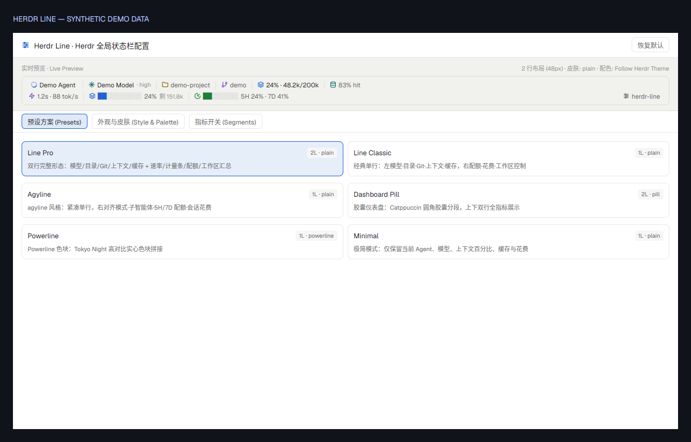

原生组件预览 · 合成示例数据，非真实会话。

# Herdr Line (`herdr-line`)

在 **Herdr 层面**实现的统一全局底部状态栏插件与可视化配置器。

保留每个窗格原本清爽的顶部标题栏不动，在工作区底部固定提供一套高颜值、零侵入的 CLI 上下文状态栏：**无论你在 Herdr 中打开 Claude Code、Codex、Antigravity (`agy`)、Devin、Pi、OMP、Grok 还是其他任意终端 Agent**，都会自动识别并实时展示模型、推理档位、目录、Git 同步与改动、上下文用量与进度条、Prompt Cache 保温倒计时与命中率、TTFT / tok/s、5H/7D/额度配额以及会话成本。

---

## 核心特性

1. **真正零侵入（告别双重状态栏）**
   - **不修改** `~/.claude/settings.json`、`~/.gemini/antigravity-cli/settings.json` 等任何 CLI 的 `statusLine` 配置；各 CLI 内部保持原样。
   - **不劫持**窗格顶部 `pane` Header，普通 `zsh` 窗格与分屏控制按钮完全保持原生体验。
2. **全 Agent 被动采集总线（开箱即用，无需重启已有会话）**
   - **Claude Code**：通过 `~/.claude/sessions/<pid>.json` 精确关联终端进程树与 `~/.claude/projects/<slug>/<sessionId>.jsonl`，并支持读取 `dcc` 本地配额与缓存保温倒计时。
   - **Codex**：被动读取 `~/.codex/sessions/**/rollout-*.jsonl` 的 `turn_context`、`last_token_usage` 与 `rate_limits`（5H / 7D 配额）。
   - **Antigravity (`agy`)**：被动读取 `settings.json` 与活跃会话 `transcript.jsonl`（含子智能体统计）。
   - **Devin (`devin`)**：通过 `session_locks/*.lock` 与进程父子链（含工具执行子进程）精确匹配 `sessions.db` 中的上下文、缓存、TTFT、tok/s 与 ACU。
   - **Pi / OMP**：同时支持免重启读取 `sessions/*.jsonl` 与通过 `extensions/herdr-ccline.ts` 实时推送。
   - **Grok & 通用终端兜底**：支持 `~/.grok/sessions` 摘要识别；未知未来 CLI 自动优雅降级展示程序图标、工作计时、子智能体与非阻塞 SWR Git 状态（`GIT_OPTIONAL_LOCKS=0`，绝不锁索引）。
3. **Herdr Line 视觉体系与实时配置器**
   - **6 套内置预设**：`Line Pro`（双行 48px）、`Line Classic`（单行 30px）、`Agyline`、`Dashboard Pill`、`Powerline`、`Minimal`，切换预设时自动联动调整 Herdr 底栏高度。
   - **4 种分段皮肤**：`Plain │`、`Pill 胶囊`、`Powerline 色块`、`[Bracket]`。
   - **7 套主题调色板**：默认跟随当前 Herdr 主题（明暗自适应），内置 `Catppuccin Mocha`、`Tokyo Night`、`Rosé Pine`、`Dracula`、`Nord`、`Gruvbox`。
   - **内置可视化配置弹窗**：点击底栏右侧 `herdr-line` 按钮、命令面板搜索 `Herdr Line`，或执行 `herdr-app do mod.open --name ccline` 即可边看实时预览边调整。

---

## 改名与旧版兼容

仓库和 npm 包现名为 **herdr-line**，界面显示 **Herdr Line**。为保证已安装用户的布局、快捷键、缓存和设置继续工作，以下 legacy 标识刻意保持不变，**不是旧产品显示名**：

- Herdr 内部 mod ID / 安装目录：`ccline` / `mods/ccline/`；打开命令仍为 `herdr-app do mod.open --name ccline`。
- Pi 扩展安装文件：`extensions/herdr-ccline.ts`。不要再另装一份改名扩展，以免重复采集。
- 默认运行数据及备份目录：`~/.config/herdr-ccline/`；已有覆盖变量 `HERDR_CCLINE_HOME` 继续有效。此次不移动、清理或迁移用户数据。
- 持久化共享键：`ccline.config`、`ccline.snapshot`；预设 ID `cometix-pro` / `cometix` 仍有效，对应显示名改为 Line Pro / Line Classic。

仓库新地址：https://github.com/shentry/herdr-line 。已有 Git 克隆可用 `git remote set-url origin https://github.com/shentry/herdr-line.git` 更新地址；不需要重新安装或改动个人布局。

## 安装与激活

先预览将要安装的白名单文件（默认不写入任何文件）：

```sh
python3 scripts/install.py --dry-run
```

安装插件源码并激活到你克隆的个人布局（如 `main-timers`，不会修改 Herdr 只读内置布局）：

```sh
python3 scripts/install.py --apply --activate-layout main-timers
```

若后续更新插件代码，带 `--replace` 会先在 `~/.config/herdr-ccline/backups/` 生成 `0600` 权限备份再原子替换：

```sh
python3 scripts/install.py --apply --replace --activate-layout main-timers
```

打开可视化配置面板：

```sh
herdr-app do mod.open --name ccline
```

---

## 目录结构

```text
herdr-line/
├── mods/ccline/
│   ├── main.js          # GPUI 底栏视图 + 交互式配置器弹窗
│   ├── layout.js        # 预设、皮肤、配色、进度条与宽度自适应折叠引擎
│   ├── collector.py     # Python 3.9+ 标准库多 Agent 被动采集器 + SWR Git 缓存
│   ├── mod.json         # Herdr mod 元数据与命令面板入口
│   └── icons/           # 模型家族与指标矢量图标
├── extensions/
│   └── herdr-ccline.ts  # 可选 Pi 实时状态推送扩展
├── scripts/
│   └── install.py       # 白名单原子安装器（拒绝符号链接与内置只读布局覆盖）
├── tests/               # Node 布局测试 + Python 全 Adapter 单元测试
├── config.example.json  # 配置结构示例
├── keys.json            # 可选快捷键片段
└── RECIPE.md            # Herdr 插件构建规范说明
```

---

## 测试验证

```sh
npm test
herdr-app check ~/.config/herdr-app/mods/ccline
```

## 许可证与发布说明

按 [MIT License](LICENSE) 发布，版权声明为 2026 shentry。

已提供由 Herdr 原生渲染真实配置器组件的合成数据预览 [preview.png](preview.png)，不是绘制的产品示意图。[截图来源与限制](docs/preview.md)。Gallery 收录与实际客户端端到端验收仍需另行确认。

## 设计参考与致谢

原始视觉设计参考 CCometixLine 与 agyline；更名为 Herdr Line 不移除这一设计来源说明。原有许可证及版权声明保持不变。
