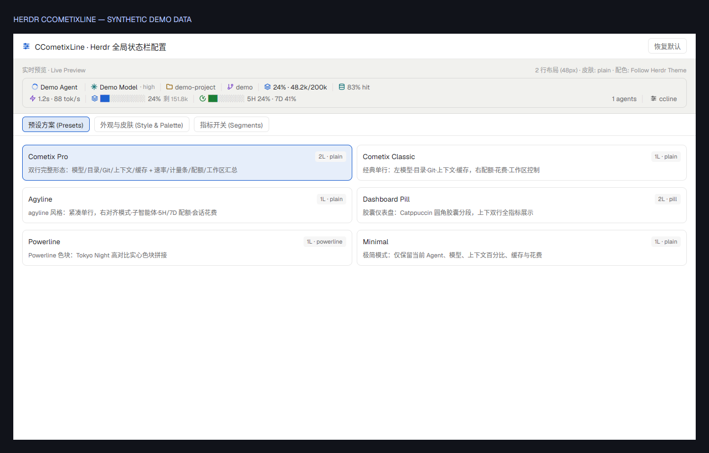

# Herdr CCometixLine

预览图由 Herdr 0.1.18 原生渲染本插件的真实配置器组件生成；画面明确标注合成示例数据，无真实聊天、私人路径或会话 ID。[截图来源与限制](docs/preview.md)。Gallery 收录仍需另行确认。

在 Herdr 工作区底部提供统一的 `CCometixLine` / `agyline` 风格全局 CLI 状态栏，并附带原生可视化配置弹窗。保留每个终端窗格原有的顶部标题栏与各自 CLI 配置不变，自动追踪当前活跃的任意编码 Agent（Claude Code、Codex、Antigravity、Devin、Pi、OMP、Grok 及通用终端）。

## What you see

- 工作区底部状态栏（双行模式高 48px，单行模式自动缩放至 30px/28px），顶部带 1px 主题边框，背景与文字颜色默认跟随 Herdr 当前主题，也可切换 Catppuccin Mocha、Tokyo Night、Rosé Pine、Dracula、Nord、Gruvbox 调色板。
- 双行旗舰预设（`Cometix Pro`）：第一行左侧依次显示当前追踪的 Agent 徽章（多 Agent 时显示 `1/N`）、模型家族矢量图标与模型名称/推理档位、目录名、Git 分支/脏状态/超前落后/增删行数、上下文百分比与 Token 数、Prompt Cache 倒计时与命中率；第一行右侧显示运行模式、工作计时/子智能体数与会话花费。第二行左侧显示首字延迟（TTFT）与生成速率（tok/s）、上下文进度条、5H/7D/额度配额条与会话标识；第二行右侧显示工作区机器名与全局 Agent 数（有阻塞时高亮 `! N needs you`）、`ccline` 配置按钮与命令面板快捷键提示。
- 通过点击底栏 `ccline` 按钮或 `herdr-app do mod.open --name ccline` 打开 780×640 的配置器弹窗：顶部为实时预览卡片，下方分为“预设方案”、“外观与皮肤”、“指标开关”三个标签页，支持一键切换 Plain / Pill / Powerline / Bracket 皮肤、进度条字符集及 16 项指标开关。

## How it behaves

- 智能跟随：聚焦某个 Agent 窗格时立即显示该 Agent 的上下文状态；若焦点暂时切到同标签页的普通终端或侧边栏，智能保持显示当前标签页或空间内的活跃 Agent。点击左侧 Agent 徽章可在空间内多个 Agent 之间循环切换聚焦；点击 `! N needs you` 直接跳转至等待确认的 Agent。
- 自适应宽度：通过 `on_size_change` 监听底栏逻辑像素宽度，窗口变窄时按优先级自动从完整文案降级到紧凑文案、极简文案直至隐藏次要项，不遮挡核心指标。
- 节能刷新：仅在窗口可见（`window()?.visible !== false`）且非 `herdr-app check` 时每 2 秒单次批量采集当前空间的终端；1 秒级 UI 时钟仅在存在 `working` 计时或缓存保温倒计时期间激活，空闲时不产生多余重绘。

## Built from

- `mods/ccline/main.js`、`mods/ccline/layout.js`、`mods/ccline/mod.json` 与 `mods/ccline/icons/*.svg`：基于 `gpui-kit` / `gpui-base` 构建双模式视图，使用 `shared("ccline.config")` 跨底栏与配置弹窗实时同步状态，必要时通过 `layout.resize` 同步底栏高度。
- `mods/ccline/collector.py`：仅依赖 Python 3.9+ 标准库。单次 `ps` 快照构建进程父子链，被动只读解析 Claude Code (`~/.claude/sessions` + `projects`)、Codex (`~/.codex/sessions`)、Antigravity (`transcript.jsonl`)、Devin (`session_locks` + `sessions.db`)、Pi/OMP (`sessions/*.jsonl`)、Grok (`summary.json`)，并以 `GIT_OPTIONAL_LOCKS=0` 维护 5 秒 TTL 的 Git 状态缓存。
- `extensions/herdr-ccline.ts`：可选 Pi 扩展，在会话与工具事件后原子写入 `~/.config/herdr-ccline/agents/<terminal>.json`。
- `scripts/install.py`：白名单安全安装器，默认 `--dry-run`，拒绝符号链接与 Herdr 内置只读布局覆盖，替换已有文件前保留 `0600` 私有备份。

## Watch out

- `checking()` 为真时必须在初始化状态后立即返回，不启动定时器、子进程或 `layout.resize`。
- GPUI 颜色参数必须为 `#rgb` / `#rrggbb` / `#rrggbbaa` 十六进制颜色，不能传入裸颜色名或 `"transparent"`。
- Codex 的 `last_token_usage.input_tokens` 已包含 `cached_input_tokens`，计算总上下文时不能重复相加；Claude Code 与 Antigravity 的 `input_tokens` 则为未缓存输入，需与 `cache_read` 相加。
- 不要修改任何 CLI 的全局 `settings.json` `statusLine`，否则会在终端内部与 Herdr 底栏产生重复状态条。
- 运行时缓存保存在 `~/.config/herdr-ccline/`（权限 `0700`/`0600`），不可提交到公开仓库。

## Done when

1. `npm test` 通过：覆盖模型家族与 `[1m]` 窗口解析、Claude/Codex/Devin/Antigravity/Pi/Grok 被动采集、Git SWR 缓存、布局预设与窄屏自适应折叠，以及安装器干跑/白名单/内置布局保护。
2. `python3 scripts/install.py --apply --activate-layout main-timers` 成功安装并写入个人克隆布局，不触碰任何 CLI `settings.json`。
3. `herdr-app check ~/.config/herdr-app/mods/ccline` 零错误通过，`herdr-app status` 中 `errors` 为空。
4. `herdr-app shot` 实机截图验证：窗格顶部恢复原生 `pane` 标题栏，工作区底部清晰渲染 `CCometixLine` 双行状态栏，且打开配置器弹窗预览与切换正常。
